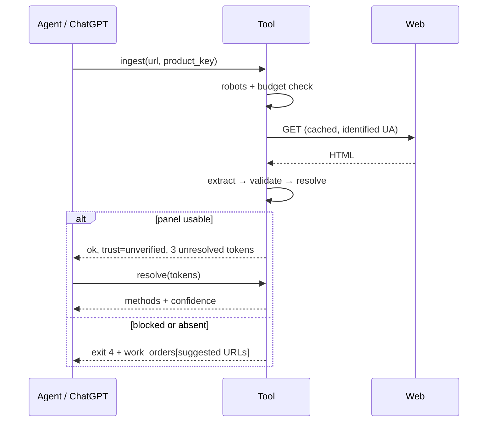

# Agent interface

The tool is a library with a command surface. Humans get the same surface; an
agent is the expected caller. Language: Go 1.26 (see
[`decisions/0001-language.md`](decisions/0001-language.md)); the contract below
is language-neutral: **JSON on stdout, logs on stderr, no prompts, no TTY
assumptions.**

> **v1 scope (2026-10-26).** The full contract below is the target, not the
> first release. v1 implements `lookup`, `search`, `parse`, `analyze`,
> `resolve`, `shelf`, `export json|csv`, `doctor` over a local `data/`
> directory, plus stdio MCP. Deferred: `ocr`, `ingest` and batch jobs,
> `job get/ls`, `export sqlite`, job files/locks/queue, multi-agent claims and
> the remote/public MCP endpoint. Exit codes, the envelope, work orders and
> provenance stay as written.

## 1. Principles

1. **One shot per call.** No REPL, no interactive confirmation, no hidden state
   besides the cache and the data dir.
2. **JSON is the API.** Every command emits one envelope object. Human-readable
   rendering is a separate `--text` mode and is never what an agent parses.
3. **Never lie about certainty.** `confidence` and `trust` are mandatory fields,
   not decoration. Missing data is `null`, unresolved tokens are kept verbatim.
4. **Hand work back.** A run that cannot finish returns structured work orders
   and exit code `4`; it does not fail, and it does not guess.
5. **Idempotent.** Re-running a command with unchanged inputs produces an
   unchanged data dir and an empty diff. Unchanged content must not rewrite a
   generated file or change `fetched_at`; hash the content, not the wall clock.
6. **Deterministic.** Same inputs + same registry content hash + `--seed 0` →
   same output. Registry identity is the CSV with export metadata removed, plus
   the Commission's `last_update`; raw file bytes are audit data, not identity.
   Local-model steps record their model id and version.

## 2. Envelope

Every command, success or not:

```json
{
  "ok": true,
  "exit": 0,
  "data": {},
  "warnings": [{ "code": "cosing_mirror_used", "message": "…" }],
  "work_orders": [],
  "registry": { "cosing_annexes": "2026-10-13", "sha256": "…" },
  "next": ["ingest --urls urls.txt"]
}
```

`warnings` and `work_orders` are always present, even when empty — an agent must
never have to distinguish "absent" from "none".

## 3. Commands

Fast, local, synchronous unless noted.

| Command | In | Out (`data`) | v1 |
|---|---|---|---|
| `lookup <barcode>` | barcode | product record or `not_found` | yes |
| `search <query>` | name/brand | ranked product keys, with `match_reason` | yes, exact/substring only |
| `parse` | `--file`, `--text`, or stdin | ordered ingredient list + `unresolved[]` | yes |
| `ocr <image…>` | paths | text + list (job if > 1 image) | deferred |
| `analyze` | `--file` / stdin / `--product` | per-ingredient canonical + functions + annex status | yes |
| `ingest <url…>` | URLs, optional `--barcode` `--product-key` | observations stored; **job if > 1 URL** | deferred |
| `resolve <token…>` | printed tokens | canonical guess + `method` + `confidence` | yes, deterministic only |
| `shelf add <barcode>` / `shelf ls` / `shelf rm` | shelf name | membership + rollup | yes |
| `job get <id>` / `job ls` | — | job state, partial results | deferred |
| `export --format json\|csv\|sqlite` | — | path + sha256 | json/csv only |
| `doctor` | — | registry versions, cache size, source health, host budgets | yes |

Global flags: `--json` (default for non-TTY), `--text`, `--data-dir`,
`--cache-dir`, `--offline`, `--refresh`, `--wait`, `--timeout`, `--seed`.

**`--offline` is a hard guarantee:** no network, cache-only reads, and it must
succeed for `lookup`, `parse`, `analyze`, `resolve`, `shelf`, `export`.

### Exit codes

| Code | Meaning |
|---|---|
| `0` | stored/returned, nothing needed |
| `1` | done but incomplete (`trust: unverified`, some tokens unresolved) |
| `2` | usage error |
| `3` | not found, and nothing to try |
| `4` | needs agent input — `work_orders` non-empty |
| `5` | blocked by policy (robots, anti-AI group, protected host) |
| `10` | internal error (bug) |

Distinguishing `3` from `4` is the point: `3` means "stop looking", `4` means
"there is reachable work".

## 4. Work orders

An agent can act on these directly; CI can too.

```json
{
  "id": "wo_01J…",
  "kind": "fetch_url | decide | resolve_token | manual_label | confirm_product",
  "reason": "robots_ai_group | bot_protection | no_panel | ambiguous_size | low_resolution",
  "blocking": true,
  "payload": { "product_key": "ean:…", "tried": ["…"], "tokens": ["…"] },
  "suggested": [{ "action": "fetch", "url": "…", "why": "brand page allows bots" }],
  "constraints": { "max_requests": 3, "must_record_provenance": true }
}
```

Rules for the caller: act on `suggested`, feed results back through `ingest` or
`parse`; never invent a panel to satisfy a work order; `blocking: false` means
the record is still usable.

## 5. Jobs

**v1 has no jobs.** `ingest` is deferred; `lookup`, `parse`, `analyze` and
`resolve` are fast and synchronous. If a future command exceeds the caller's
timeout, it may return a job envelope — the shape below is the target, not a
v1 requirement.

Slow work (`ingest` with many URLs, `ocr` batch, `export` of the full corpus)
returns immediately:

```json
{ "ok": true, "exit": 0, "data": { "job": "job_01J…", "state": "queued", "eta_s": 40 } }
```

States: `queued → running → done | partial | failed`. `job get` returns the same
envelope plus `progress { done, total }` and any work orders produced so far.
Jobs are files under `state/jobs/<id>.json`; they survive a restart and are the
same object CI polls.

## 6. MCP surface

Wrap the commands; do not grow a second API.

| Tool | Maps to | Class |
|---|---|---|
| `lookup_product` | `lookup` | read |
| `search_products` | `search` | read |
| `parse_ingredients` | `parse` | read |
| `analyze_inci` | `analyze` | read |
| `get_ingredient` | ingredient record | read |
| `job_status` | `job get` | read |
| `ingest_url` | `ingest` | **write** |
| `shelf_add` / `shelf_rm` | `shelf` | **write** |

Transports: **v1 ships stdio only.** Streamable HTTP and the public endpoint are
deferred: ChatGPT needs a public host and a Business/Enterprise plan for full
MCP, and publishing the shelf would leak personal data. The read/write split
below is the target when that changes.

Publish **read tools only** on the public endpoint: ChatGPT Pro can connect
custom MCP servers with read/fetch permissions, and nobody else's ChatGPT should
be able to write to the shelf. Write tools stay behind stdio or auth.

Each tool description must state the data caveat inline — "ingredient order is
not concentration; below 1 % any order is legal" — because the model, not the
UI, writes the prose.



## 7. Data on disk

```
data/
  products/<ean-or-key>.json      one product, ordered ingredients
  ingredients/<slug>.json         canonical INCI record + functions + annex
  sources/<sha256>.json           one observation, with provenance
  shelf/<name>.json               membership + rollup
  registry/cosing/                annex_II..VI.csv + manifest.json
  index/products.json             barcode → key/name/brand (search seed)
  index/ingredients.json
cache/http/<host>/<sha>.body      + .meta.json (etag, fetched_at, status)
```

Deferred (not created in v1): `state/jobs/<id>.json`, `state/locks/`,
`queue/<work-order-id>.json`. `cache/` and `local/` are gitignored; `data/` is
committed in the public repo. The personal shelf and scraped observations live
in `local/` unless explicitly published. The registry `manifest.json` records
the stripped content hash, `last_update`, source URL and `fetched_at`; the raw
CSVs are audit data.

Product record, minimum shape:

```json
{
  "product_key": "ean:3600542134567",
  "barcode": "3600542134567",
  "brand": "…",
  "name": "…",
  "size": "50 ml",
  "ingredients": [
    { "position": 1, "printed": "Aqua", "canonical": "AQUA",
      "functions": ["SOLVENT"], "annex": null,
      "declared_pct": null, "method": "exact", "confidence": 1.0 }
  ],
  "may_contain": [],
  "unresolved": [],
  "trust": "verified|probable|unverified|conflict|manual",
  "sources": ["sha256:…"],
  "generated": true
}
```

Every file carries `generated: true` and a `generator_version`. Hand edits are
overwritten by the next build — that is the point.

## 8. Coordination

**v1 is single-process.** No locks, claims, queue or job files; writers use
`<path>.tmp` + rename for crash safety. The multi-agent protocol below is the
target, not a v1 requirement.

Multiple agents (and CI) may run at once.

- **One writer per file.** Writers take `state/locks/<path>.lock` with `O_EXCL`,
  write to `<path>.tmp`, then rename. A stale lock (> 15 min without heartbeat)
  is reclaimable.
- **Queue claims.** A work order is claimed by writing
  `queue/<id>.claim` = `{agent, ts}`. Claimed orders are skipped by others.
- **No cross-agent conversation needed.** All coordination is in files; an agent
  that dies leaves a stale claim, not a wedge.
- **`ingest` never mutates an existing `verified` product** without
  `--force`; conflicting observations append a `sources[]` entry and raise
  `trust` handling per [`scraping.md`](scraping.md) §5.

## 9. Non-goals for the interface

- Streaming partial tokens to a chat.
- Any verb that needs a paid key.
- Any verb returning prose only. Every human-facing sentence is derived from the
  JSON, not the other way round.
